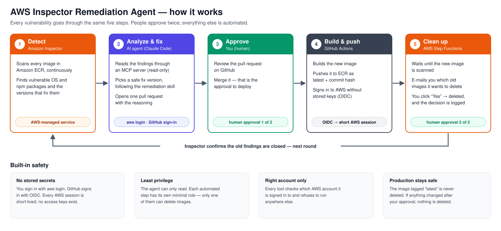

# AWS Inspector Remediation Agent

Automates the manual loop of fixing AWS Inspector package vulnerabilities in container images:
find → analyze → bump package → open PR → deploy → clean up old ECR images → verify resolved.

Built with Claude (Claude Code), an MCP server, an agent skill and an eval suite; the deploy and cleanup run serverless on AWS.

> Status: ✅ M3 – agent fixes all findings of an image in one pull request (95 → 1 findings in the sandbox) · ✅ M5a – after every push of `latest`, AWS verifies the scan, e-mails a cleanup plan and deletes old images on approval · 🚧 M4 evals

## The problem

Today this is a manual, repetitive workflow:

1. Open AWS Inspector and review findings
2. Analyze each finding (which package, direct or transitive, actually relevant?)
3. Check whether a fixed version is available
4. Update the package in the service repository
5. Deploy
6. Delete outdated ECR images
7. Re-check Inspector to confirm the finding is resolved

It is time-consuming, easy to postpone and requires context switching between Inspector, the repo, CI/CD and ECR.

## The solution



Details in [docs/architecture.md](docs/architecture.md). Before automating, the loop was run once by hand – the [manual baseline run](docs/manual-run.md) lists the edge cases the agent has to handle.

## MCP server

A read-only TypeScript MCP server ([`mcp-server/`](mcp-server/)) gives Claude access to Inspector, ECR and the OSV vulnerability database:

| Tool | Purpose |
|---|---|
| `list_active_findings` | Active Inspector findings for an ECR repository, optionally per image digest or package |
| `get_image_scan_status` | Scan status of an image; resolves image indexes to their child manifests |
| `check_package_version` | Known vulnerabilities of an exact npm version (OSV) – used to validate a fix version |
| `list_images` | Images with a deletion plan; images tagged `latest` (configurable) are never deleted |

All tools are read-only. Changes happen through pull requests, deletions need human approval.

Run it with Claude Code:

```bash
cd mcp-server && npm install && npm run build && cd ..
aws login --profile inspector   # any profile with Inspector/ECR read access
claude                          # approve the project MCP server "aws-inspector"
```

Configuration (`.mcp.json`): `AWS_PROFILE` (default `inspector`), `AWS_REGION` (default `eu-north-1`), `PROTECTED_TAGS` (default `latest`) and `EXPECTED_AWS_ACCOUNT_ID` (required). The server refuses to start when the credentials belong to any other account, so a missing profile can never fall back to a different account. Unit tests: `npm test` in `mcp-server/`.

## Agent core (Python)

`agent/` groups active findings per package, tells direct, transitive and base-image packages apart and ranks them, so the model only sees one compact entry per package (71 findings → 18 packages, about 9× less context):

```bash
cd agent
EXPECTED_AWS_ACCOUNT_ID=<account-id> AWS_PROFILE=inspector uv run remediation-agent summarize \
  --repository demo-service --package-json ../sandbox/demo-service/package.json
```

Tests and lint: `uv run pytest`, `uv run ruff check .`

## Repository layout

| Path | Content |
|---|---|
| `agent/` | Python – orchestrator and sub-agents (Anthropic SDK) |
| `mcp-server/` | TypeScript – MCP server with read-only AWS tools (Inspector, ECR) |
| `.claude/skills/` | Agent skills – remediation playbook ([remediating-inspector-findings](.claude/skills/remediating-inspector-findings/SKILL.md)) |
| `infra/` | AWS CDK – Step Functions, Lambda, DynamoDB |
| `sandbox/` | Deliberately vulnerable demo service + ECR repository |
| `evals/` | Eval cases from observed mistakes and the runner ([README](evals/README.md)) |
| `docs/` | Architecture, ADRs, deployment playbook |

## Roadmap

- [x] **M0** Setup – repo, AWS sandbox account, budget alarm, Inspector, manual baseline run
- [x] **M1** MCP server – Inspector findings, ECR scan status and images, OSV version check
- [x] **M2** Analysis and prioritization – findings grouped per package, source classified, ranked
- [x] **M3** Fix agent – remediation skill, one pull request per image, approved cleanup
- [ ] **M4** Evals – cases from observed mistakes, with vs. without skill ([evals/](evals/)); later CI gate
- [x] **M5a** Serverless workflow (`infra/`, AWS CDK) – EventBridge on push of `latest` → Step Functions: wait for a stable scan, plan cleanup, approval by e-mail, delete, report; DynamoDB audit log; one Lambda per step with least privilege
- [ ] **M5b** Model in the loop – analysis and pull requests in AWS; choose Claude API or Bedrock
- [ ] **M6** Case study and demo

## Results

Baseline: fixing one package (axios, 24 findings) by hand took about 2 hours, including one failed attempt.

First agent run (Claude Code with the MCP server and the remediation skill): lodash, 5 findings – analysis, exact version bump and a documented pull request ([#1](https://github.com/hani021021/aws_inspector/pull/1)) in under 2 minutes; after merge, deploy and approved cleanup all lodash findings were `CLOSED`. Without the skill the same question produced a `^` range and no `package.json` check.

Batch runs with the agent (one pull request per image, one commit per package): [#2](https://github.com/hani021021/aws_inspector/pull/2) closed 39 of 66 findings in under 5 minutes (express 4.x instead of the suggested 5.0 beta, npm removed from the runtime image), [#3](https://github.com/hani021021/aws_inspector/pull/3) moved the base image to Alpine 3.24 and closed the 27 Debian findings that had no fix. **95 → 1** active findings in total; the remaining one is a withdrawn express advisory whose only fix is a new major version. Old images are deleted by a fixed cleanup command after the agent asks and a human says yes.

CI: GitHub Actions builds the demo service after every merge to main and pushes it as `<short sha>` and `latest`, signing in to AWS through OIDC – no stored keys; the trust policy matches GitHub's immutable subject (owner and repository IDs), so a renamed or re-created repository cannot assume the role. From merge to approval mail no manual step is left.

Serverless workflow: a push of `latest` (1.0.6) started the state machine; 4½ minutes later – scan stable, plan e-mailed, approved with one click – the three entries of 1.0.5 were deleted and the decision was recorded in DynamoDB. The first run failed because the scan did not exist yet seconds after the push; the Lambda now treats that as pending.

Evals ([evals/](evals/README.md)), first run, one trial per case: **with skill 100 %, without skill 91 %**. Only one of the four observed mistakes (reporting a finding count too early) reproduces in isolation; the others appeared in long sessions with live data. Next: harder, more realistic cases and several trials per case.

_To be filled after M5: time saved per finding, fix success rate, eval scores, cost per run._
